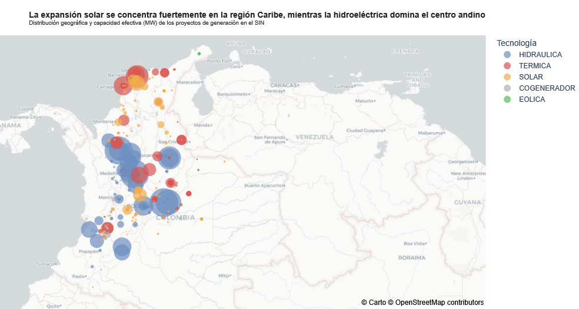

# El Sistema de Generación Colombiano: Transición y Descentralización del SIN

Este repositorio presenta un análisis exploratorio y estructurado sobre la evolución, capacidad actual y dinámica de expansión del parque de generación del Sistema Interconectado Nacional (SIN) de Colombia, abarcando proyectos en operación y en etapa de construcción.

El análisis utiliza datos oficiales e infraestructurales (UPME, XM y SUI) procesados mediante cuadernos de Python (notebooks), garantizando trazabilidad de origen y marcas temporales de extracción para evaluar las transformaciones tecnológicas y territoriales de la matriz eléctrica.

 

## Análisis del Sistema de Generación en Colombia : 

La distribución espacial del SIN refleja un marcado contraste geográfico: la generación hidroeléctrica sostiene el suministro en el interior andino aprovechando la orografía nacional, mientras que los desarrollos solares fotovoltaicos e infraestructura térmica de respaldo presentan un clúster de alta densidad en la Costa Caribe. Esta configuración evidencia el inicio de una transición energética descentralizada fuera del eje andino tradicional.

## 1. Evolución Histórica de la Matriz y Capacidad Instalada
El SIN ha superado los 25,109 MW de Capacidad Efectiva Neta. Históricamente sustentado en hidroelectricidad y respaldo térmico, el parque muestra hoy una creciente diversificación tecnológica.

 
La matriz eléctrica colombiana mantuvo un crecimiento paulatino dominado casi exclusivamente por las grandes centrales hídricas y térmicas durante más de cinco décadas. No obstante, a partir de la presente década, la incursión de tecnologías renovables no convencionales (FNCER) comienza a desplazar marginalmente el perfil de expansión acumulada.

Entre 1900 y 2020 la incorporación de plantas ocurría de forma discreta y espaciada en el tiempo. Desde 2021, la cantidad de proyectos que entran en operación anualmente se ha multiplicado exponencialmente, registrando un récord histórico en el número absoluto de activaciones durante el período reciente.

 
A pesar del volumen alto de proyectos recientes, la capacidad neta agregada anualmente muestra variaciones drásticas. El pico alcanzado en 2022 representa el punto de inflexión más alto de entrada en operación de infraestructura de gran escala en la historia reciente del país.

Mientras que los ciclos de expansión previos (1980–2015) dependían de alternancias entre hidroeléctricas de gran embalse y térmicas a gas/carbón, el flujo de proyectos incorporados en el trienio reciente está masivamente dominado por la tecnología solar fotovoltaica.

 
Existe una tendencia clara de fragmentación del parque de generación: mientras el siglo XX se caracterizó por megaproyectos individuales de cientos o miles de megavatios, los nuevos desarrollos corresponden a parques solares o autogeneradores de escala pequeña y mediana (menores a 20-50 MW promedio). Esto introduce nuevos retos operativos para el Centro Nacional de Despacho (CND) en términos de gestionabilidad y control de frecuencia.

 
Antioquia, Cundinamarca y Atlántico concentran casi el 50% de la Capacidad Efectiva Neta del país. Antioquia mantiene un liderazgo histórico indiscutible debido al aprovechamiento hídrico de sus cuencas.
 

Al aislar la capacidad incorporada en los últimos años, la geografía de la generación cambia radicalmente: Atlántico, Bolívar y Cesar lideran la nueva capacidad, impulsados por elevados niveles de irradiancia solar. Departamentos tradicionalmente hidroeléctricos como Antioquia muestran aportes marginales en la nueva capacidad neta instalada durante este período.
 

Puedes revisar el desarrollo completo en el siguiente enlace: [Ver Notebook de Análisis](Análisis%20Sistema%20de%20Generación%20en%20Colombia.ipynb)

